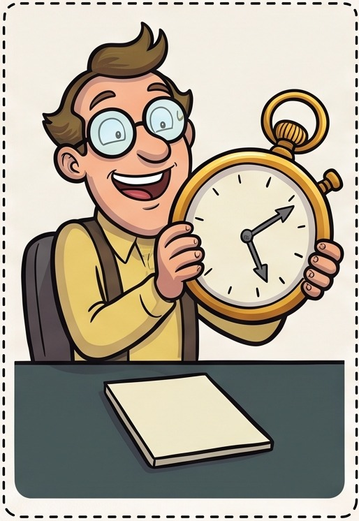
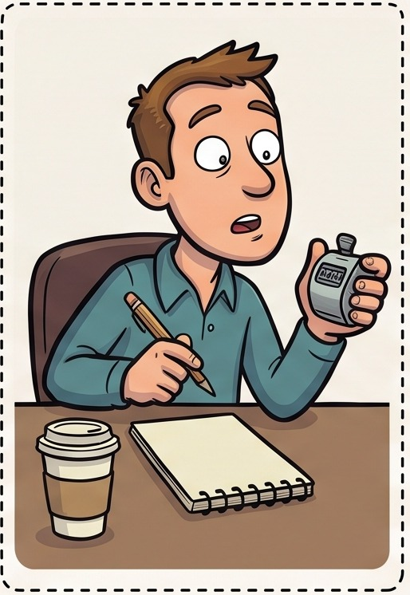
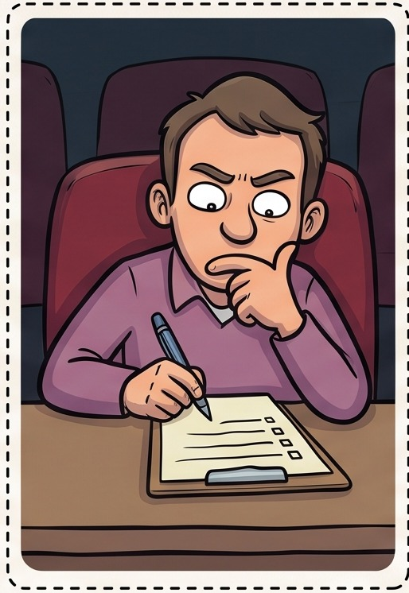
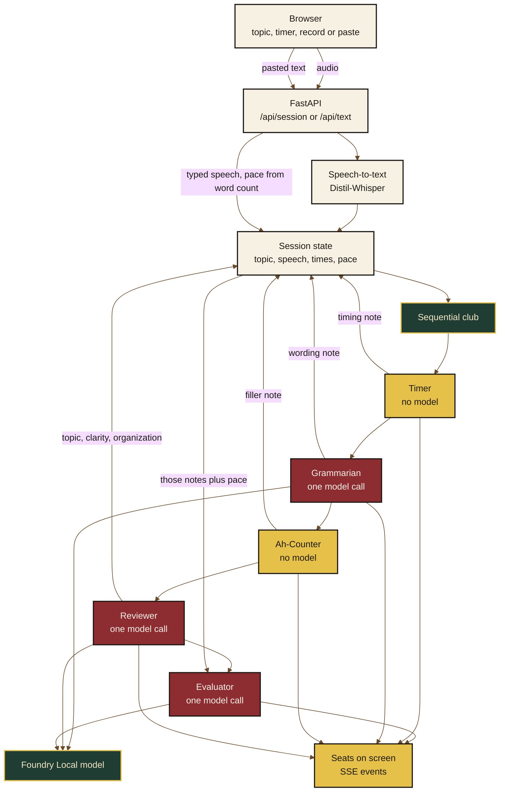

<style>
  .readme-root { color: #1c1914; }
  .mast {
    background: #10241c;
    color: #f6f1e7;
    border: 3px solid #0b1814;
    border-radius: 1rem;
    padding: 1.4rem 1.6rem 1.5rem;
    margin: 0 0 1.4rem;
    box-shadow: 0 8px 0 #0b1814;
  }
  .eyebrow {
    margin: 0;
    letter-spacing: 0.18em;
    text-transform: uppercase;
    font-size: 0.72rem;
    color: #e6c14a;
    font-family: "Trebuchet MS", "Segoe UI", sans-serif;
  }
  .mast h1 {
    margin: 0.15rem 0 0.35rem;
    font-family: Georgia, "Palatino Linotype", serif;
    font-size: 2.6rem;
    color: #f3e6c4;
    text-shadow: 0 2px 0 #3a2a12;
    border: 0;
    background: transparent;
  }
  .tagline {
    margin: 0;
    color: #d7c7a2;
    font-family: Georgia, "Palatino Linotype", serif;
    font-size: 1.05rem;
  }
  .cast {
    display: flex;
    flex-wrap: wrap;
    gap: 0.7rem;
    margin: 1.1rem 0 0.2rem;
  }
  .cast figure {
    flex: 1 1 6.2rem;
    max-width: 8rem;
    margin: 0;
    background: #8d2d32;
    color: #f6f1e7;
    border: 2px solid #1c1914;
    border-radius: 0.65rem 0.65rem 0.4rem 0.4rem;
    padding: 0.35rem 0.35rem 0.45rem;
    text-align: center;
    box-shadow: 0 5px 0 rgba(0, 0, 0, 0.28);
  }
  .cast img {
    width: 100%;
    height: 6.2rem;
    object-fit: contain;
    background: #f4efe4;
    border: 2px solid #1c1914;
    border-radius: 0.35rem;
  }
  .cast figcaption {
    margin-top: 0.35rem;
    background: #e6c14a;
    color: #1c1914;
    border: 2px solid #1c1914;
    border-radius: 0.3rem;
    font-size: 0.68rem;
    font-weight: 700;
    letter-spacing: 0.04em;
    text-transform: uppercase;
    font-family: "Trebuchet MS", "Segoe UI", sans-serif;
  }
  .panel {
    background: #e7d3a1;
    color: #1c1914;
    border: 4px solid #6b4a28;
    border-radius: 0.35rem;
    padding: 0.9rem 1.1rem;
    margin: 1rem 0 1.4rem;
    box-shadow: 0 10px 0 #6b4a28;
    font-family: "Trebuchet MS", "Segoe UI", sans-serif;
  }
  .panel strong { color: #10241c; }
</style>

<div class="mast">
  <p class="eyebrow">Local club</p>
  <h1>Table Topics</h1>
  <p class="tagline">Five seats. One speech. A sheet on the podium.</p>
  <div class="cast">
    <figure>
      
      <figcaption>Timer</figcaption>
    </figure>
    <figure>
      
      <figcaption>Grammarian</figcaption>
    </figure>
    <figure>
      
      <figcaption>Ah-Counter</figcaption>
    </figure>
    <figure>
      
      <figcaption>Reviewer</figcaption>
    </figure>
    <figure>
      
      <figcaption>Evaluator</figcaption>
    </figure>
  </div>
</div>

A browser club for Toastmasters table topics. Draw a topic, record a speech or paste one, and the five seats take their turn. Timer and Ah-Counter count on their own. Grammarian, Reviewer, and Evaluator each make one call to a model running on your machine through Microsoft Foundry Local. Whisper, the model, and the audio stay local.

<div class="panel">
  <strong>The room.</strong> A green hall, red seats, brass nameplates, and a wooden podium. Each portrait leans in while that seat is working, then the note appears under the nameplate. The evaluation sheet slides in from the side.
</div>

## How a round works



You send a speech. A recording is transcribed first. Pasted text skips Whisper, and pace is a word count. Both paths land in one session: topic, target time, elapsed time, transcript, a shortened speech, and a pace note.

The club then runs the seats in order. Each one writes its note back into that session. The browser hears them as server-sent events and paints the seat as soon as it reports.

Grammarian reads the speech. Reviewer reads the topic and the speech. The Evaluator is the seat that combines the timer, the wording, the fillers, the review, and the pace into the eight-line sheet.

| Seat | Model | Reads | Writes |
| --- | --- | --- | --- |
| Timer | No | Elapsed time against the target | Short, green, yellow, or over |
| Grammarian | Yes | The speech | What wording worked, and what to change |
| Ah-Counter | No | The full transcript | Filler counts: um, uh, ah, er, hmm, you know |
| Reviewer | Yes | Topic and speech | Topic fit, clarity, organization |
| Evaluator | Yes | The four notes plus pace | Clarity, vocal variety, audience awareness, comfort, content, excelled at, work on, challenge |

Long speeches are trimmed to an opening, a middle, and a close before they reach the model. The Ah-Counter still counts fillers on the full transcript.

## What you need

- **Python 3.10+**
- The packages in `requirements.txt`: Google ADK, LiteLLM, FastAPI, Uvicorn, and faster-whisper
- **[Foundry Local](https://learn.microsoft.com/en-us/azure/ai-foundry/foundry-local/)** on your PATH, with the service running and a chat model loaded
- A browser. The microphone is only needed when you press Record
- On the first recording, Distil-Whisper Small English downloads unless `models/distil-small.en` is already present. Transcription runs on CPU

The default model is `qwen2.5-1.5b-instruct-generic-gpu:4`. The menu lists whatever Foundry is serving, and the round uses the one you pick.

## Run the club

From the project folder:

```powershell
python -m venv .venv
.venv\Scripts\activate
pip install -r requirements.txt
foundry service start
uvicorn app.main:app --reload
```

Open [http://127.0.0.1:8000](http://127.0.0.1:8000).

| Variable | What it does |
| --- | --- |
| `FOUNDRY_MODEL` | Model id used when the page does not send one |
| `FOUNDRY_API_BASE` | Foundry’s OpenAI-compatible base URL, if `foundry service status` cannot be read |
